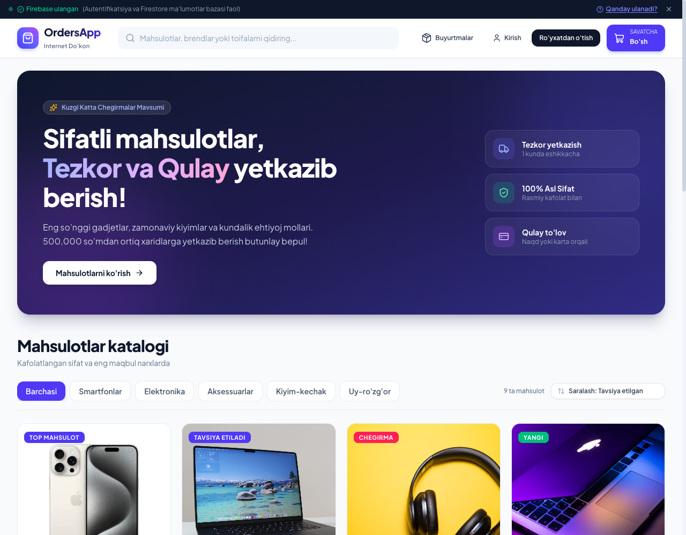
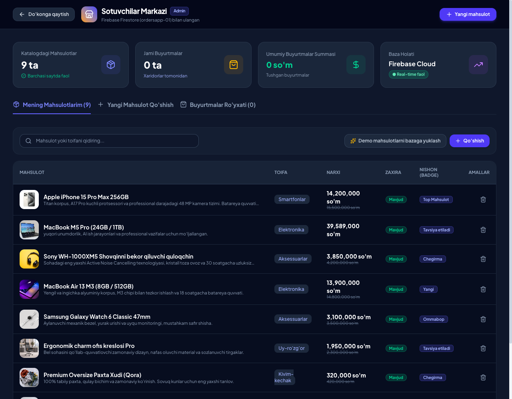
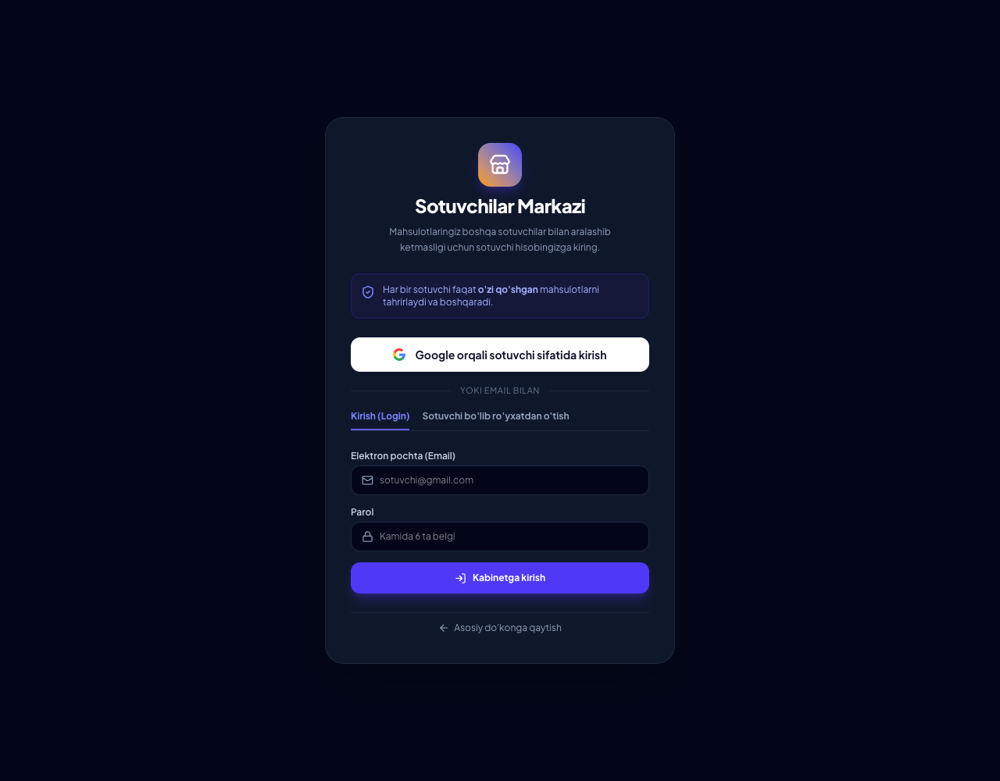

# 🛍️ OrdersApp — Full-Stack E-commerce & Multi-Vendor Platform

<div align="center">



<p align="center">
  <strong>Zamonaviy, tezkor va ko'p sotuvchili (Multi-Vendor) to'liq funksional E-commerce internet do'koni.</strong>
</p>

[](https://react.dev/)
[](https://www.typescriptlang.org/)
[](https://tailwindcss.com/)
[](https://firebase.google.com/)
[](https://vitejs.dev/)
[](https://vercel.com/)
[](LICENSE)

[🌐 Jonli Sayt (Vercel)](https://github.com/Rajabaliyev01/orders-app) • [📖 Hujjatlar](#-loyihani-ishga-tushirish) • [👨‍💻 Muallif](#-muallif-va-boglanish)

</div>

---

## 📸 Skrinshotlar / Screenshots

### 1. 🛍️ Bosh Sahifa — Mahsulotlar Katalogi


### 2. 🔐 Mijoz Login Modal


### 3. 🏪 Sotuvchilar Markazi — Auth


### 4. 📊 Sotuvchi Dashboard — Mahsulotlar Ro'yxati


### 5. ➕ Yangi Mahsulot Qo'shish


---

## 🌟 Loyiha Haqida

**OrdersApp** — zamonaviy texnologiyalar (React 19, Tailwind CSS v4, TypeScript, Firebase Auth & Firestore) asosida noldan yaratilgan, jahon standartlariga to'la javob beradigan professional internet do'koni va ko'p sotuvchili (Multi-Vendor) boshqaruv tizimi.

Loyiha ikki katta qismdan iborat:
1. **Xaridorlar Portali (Customer Shop)** — Mahsulotlar katalogi, savatcha, buyurtma berish, profil va buyurtmalar tarixi.
2. **Sotuvchilar Markazi (Seller Multi-Vendor Dashboard)** — Har bir sotuvchi uchun alohida Google/Login bilan himoyalangan kabinet, mahsulot qo'shish (Live Preview bilan), narx va zaxiralarni boshqarish hamda sotuvlar statistikasi.

---

## 📸 Skrinshotlar

<div align="center">

### 1. Asosiy Do'kon va Mahsulotlar Katalogi


### 2. Sotuvchilar Markazi (Dark Dashboard)


### 3. Sotuvchilar Alohida Kirish Oynasi (Google Auth Gate)


</div>

---

## ✨ Asosiy Imkoniyatlar va Funksiyalar

### 🛒 1. Xaridorlar uchun (Buyer Experience)
- **Real-time Mahsulotlar Katalogi**: Firebase Cloud Firestore bilan sinxronlashgan real-vaqt rejimida yangilanuvchi mahsulotlar oqimi (`onSnapshot`).
- **Filtrlash va Qidiruv**:
  - Kategoriya bo'yicha saralash (Smartfonlar, Elektronika, Aksessuarlar, Kiyim-kechak, Uy-ro'zg'or va b.)
  - Jonli tezkor qidiruv (Live Search)
  - Narx (arzondan qimmatga / qimmatdan arzonga) va reyting bo'yicha tartiblash.
- **Mukammal Savatcha (Cart State)**:
  - `localStorage` bilan to'liq sinxronizatsiya (sahifa yangilanganda ham savatcha saqlanib qoladi)
  - Brauzerning turli tablari o'rtasida real-vaqt sinxronlashuv (`StorageEvent`)
  - Bepul yetkazib berish progress indikatori
  - Mahsulot sonini oshirish/kamaytirish va tezkor tozalash.
- **Tezkor Buyurtma Berish (Checkout)**:
  - Ism, telefon, shahar va manzilni kiritish formasi
  - To'lov usullari (Naqd pul, Karta, Payme/Click)
  - Buyurtmani Firestore `orders` bazasiga va lokal tarixga saqlash.
- **Autentifikatsiya (Firebase Auth)**:
  - Google orqali 1 marta bosish bilan xavfsiz kirish (OAuth)
  - Email va parol orqali ro'yxatdan o'tish va kirish.
- **Buyurtmalar Tarixi**:
  - Har bir buyurtmaning unikal ID raqami, buyurtma qilingan vaqti va holatlari (*"Kutilmoqda"*, *"Yetkazilmoqda"*, *"Yetkazildi"*).

### 💼 2. Sotuvchilar uchun (Multi-Vendor Seller Dashboard)
- **Alohida Sotuvchilar Avtorizatsiyasi**:
  - Sotuvchilar do'konga o'zlarining shaxsiy Google yoki Email hisoblari orqali kirishadi.
  - Har bir sotuvchining mahsulotlari boshqa sotuvchilar bilan aralashib ketmaydi.
- **Mahsulotlarni Boshqarish (CRUD)**:
  - Yangi mahsulot qo'shish (nomi, toifasi, sotuv narxi, eski chegirma narxi, tavsifi, zaxirasi, nishonlar)
  - **Dinamik texnik parametrlar (Specs)**: Xotira, Rang, Kafolat kabi xususiyatlarni cheksiz qatorlarda qo'shish
  - **Jonli ko'rinish (Live Preview)**: Formada kiritilayotgan mahsulot xaridorlar ko'zida qanday ko'rinishini real-vaqtda ko'rish
  - **Umumiy katalog bilan lahzalik sinxronlash**: Sotuvchi qo'shgan mahsulot bir vaqtning o'zida Firestore va umumiy katalogda eng yuqorida paydo bo'ladi.
  - Mahsulot kartochkalarida sotuvchi do'kon nomi aks etadi (`Sotuvchi: {Do'kon}`).
  - Faqat o'ziga tegishli mahsulotlarni o'chirish huquqi (xavfsizlik kafolatlangan).
- **Sotuvchi Statistikasi**:
  - Faol mahsulotlar soni
  - Sotuvchiga tushgan jami buyurtmalar
  - Sotuvchi tushumi (Revenue) hisob-kitobi.

---

## 🛠 Texnologiyalar To'plami (Tech Stack)

| Yo'nalish | Texnologiya | Tavsif |
|---|---|---|
| **Frontend Kutubxonasi** | **React 19** | Eng so'nggi barqaror React versiyasi |
| **Til** | **TypeScript** | Xatoliklarni minimallashtiruvchi qat'iy tiplashtirish |
| **Yig'uvchi (Bundler)** | **Vite 8** | Chaqmoqdek tez HMR va zamonaviy Rolldown optimallashtirish |
| **Stillar (Styling)** | **Tailwind CSS v4** | Yangi avlod yuqori unumli CSS dvigateli |
| **Backend & Cloud** | **Firebase SDK v9+ Modular** | Firebase Auth (Google + Email), Cloud Firestore, Analytics |
| **Holat Boshqaruvi** | **Context API & Zustand** | Global savatcha va foydalanuvchi holati boshqaruvi |
| **Ikonkalar** | **Lucide React** | Yengil va zamonaviy vektor belgilar |
| **Deploy & Hosting** | **Vercel** | Avtomatik CI/CD va global CDN serverlar |

---

## 📁 Loyiha Strukturasi

```
orders-app/
├── index.html                  # Asosiy HTML hujjati
├── vite.config.js              # Vite va Tailwind v4 konfiguratsiyasi
├── vercel.json                 # Vercel SPA routing qoidalari
├── tsconfig.json               # TypeScript qat'iy sozlamalari
├── package.json                # Loyiha paketlari va skriptlar
├── .env.example                # Namuna muhit o'zgaruvchilari
├── public/
│   ├── favicon.svg             # Do'kon logotipi
│   ├── images/                 # Mahsulotlar uchun lokal rasmlar
│   └── screenshots/            # Portfolio uchun skrinshotlar
└── src/
    ├── main.jsx                # React root initsializatsiyasi va ErrorBoundary
    ├── App.jsx                 # Asosiy sahifalar marshrutlash (Shop / Seller)
    ├── index.css               # Tailwind CSS v4 uslublari
    ├── vite-env.d.ts           # Vite mijoz tiplari
    ├── types/
    │   └── index.ts            # Product, Cart, Order, User domen tiplari
    ├── lib/
    │   └── firebase.ts         # Firebase Auth, Firestore CRUD va konfiguratsiya
    ├── context/
    │   ├── AuthContext.tsx     # Foydalanuvchi va buyurtmalar holati
    │   └── CartContext.tsx     # Savatcha, localStorage va narx hisoblash
    ├── store/
    │   └── useCartStore.ts     # Alternativ Zustand do'koni (persist middleware)
    ├── hooks/
    │   └── useProducts.ts      # Firestore real-time onSnapshot + lokal sinxronizatsiya
    ├── data/
    │   └── products.js         # Boshlang'ich mahsulotlar va toifalar ro'yxati
    └── components/
        ├── ErrorBoundary.jsx   # Xatoliklarni ushlovchi himoya qatlami
        ├── Navbar.jsx          # Qidiruv, logo, savatcha va profil menyusi
        ├── Banner.jsx          # Promo aksiya va afzalliklar banneri
        ├── CategoryFilter.jsx  # Toifalar va saralash teglari
        ├── ProductCard.jsx     # Mahsulot kartochkasi (Sotuvchi yorlig'i bilan)
        ├── ProductModal.jsx    # Mahsulot tafsilotlari modali
        ├── CartDrawer.jsx      # O'ng tomondan chiquvchi qulay savatcha
        ├── CheckoutModal.jsx   # Buyurtma rasmiylashtirish oynasi
        ├── AuthModal.jsx       # Xaridorlar uchun kirish/ro'yxatdan o'tish
        ├── OrdersModal.jsx     # Buyurtmalar tarixi
        ├── SellerDashboard.tsx # Sotuvchilar boshqaruv markazi va Auth Gate
        ├── NotificationToast.jsx # Tizim bildirishnomalari
        ├── FirebaseConfigBanner.jsx # Firebase ulanish holati indikatori
        └── Footer.jsx          # Afzalliklar, sotuvchilar chaqirig'i va kontaktlar
```

---

## ⚡️ Loyihani Ishga Tushirish

### 1. Repozitoriydan nusxa olish:
```bash
git clone https://github.com/Rajabaliyev01/orders-app.git
cd orders-app
```

### 2. Bog'liqliklarni o'rnatish:
```bash
npm install
```

### 3. Muhit o'zgaruvchilarini sozlash:
`.env.example` faylidan nusxa olib, `.env.local` faylini yarating:
```bash
cp .env.example .env.local
```
O'zingizning Firebase kalitlaringizni kiriting:
```env
VITE_FIREBASE_API_KEY=AIzaSy...
VITE_FIREBASE_AUTH_DOMAIN=sizning-app.firebaseapp.com
VITE_FIREBASE_PROJECT_ID=sizning-app
VITE_FIREBASE_STORAGE_BUCKET=sizning-app.firebasestorage.app
VITE_FIREBASE_MESSAGING_SENDER_ID=...
VITE_FIREBASE_APP_ID=1:...:web:...
VITE_FIREBASE_MEASUREMENT_ID=G-...
```

*(Eslatma: Agar Firebase kalitlari kiritilmasa, loyiha avtomatik tarzda to'liq offline **Demo rejimida** ishlayveradi).*

### 4. Dasturni ishga tushirish:
```bash
npm run dev
```
Brauzerda oching: `http://localhost:3000`

### 5. Ishlab chiqarish uchun yig'ish (Build):
```bash
npm run build
```

---

## ☁️ Vercel'ga Deploy Qilish

Loyiha Vercel platformasi uchun to'liq optimallashtirilgan:
1. Loyihani GitHub'ga yuklang.
2. [Vercel.com](https://vercel.com) da **Add New Project** orqali repozitoriyani tanlang.
3. **Environment Variables** bo'limiga `.env.local` dagi `VITE_FIREBASE_*` o'zgaruvchilarini kiriting.
4. **Deploy** tugmasini bosing — sayt bir necha soniyada butun dunyoga tarqaladi!

---

## 👨‍💻 Muallif va Bog'lanish

Loyihani yaratuvchisi va dasturchisi: **Javohir Rajabaliyev**

- 📱 **Telefon**: [+998 33 007 30 07](tel:+998330073007)
- ✈️ **Telegram**: [@Rajabaliyev_01](https://t.me/Rajabaliyev_01)
- 📷 **Instagram**: [@Rajabaliyev_01](https://instagram.com/Rajabaliyev_01)
- 🐙 **GitHub**: [@Rajabaliyev01](https://github.com/Rajabaliyev01)
- 📍 **Manzil**: Jizzax shahri, O'zbekiston

---

## 📄 Litsenziya

Ushbu loyiha [MIT](LICENSE) litsenziyasi asosida ochiq taqdim etiladi. Erkin foydalanishingiz, o'zgartirishingiz va o'z loyihalaringizda qo'llashingiz mumkin.
